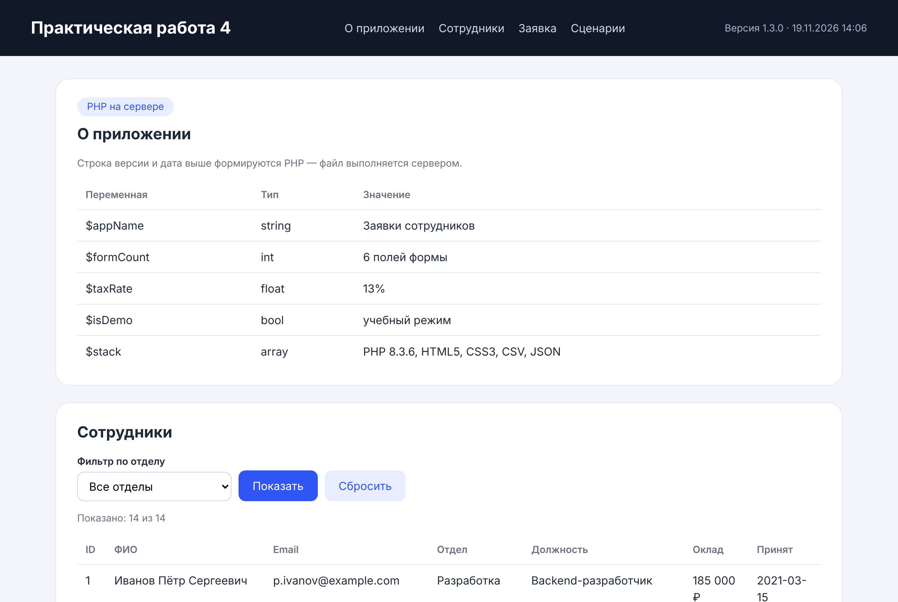
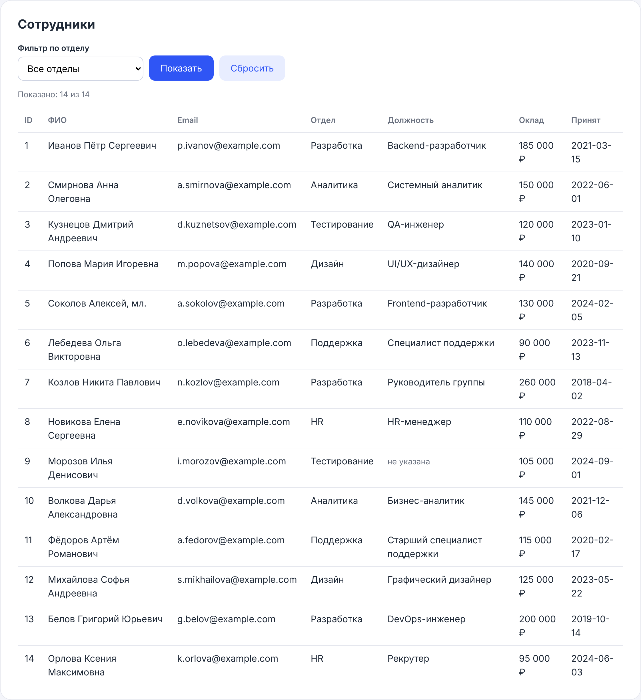
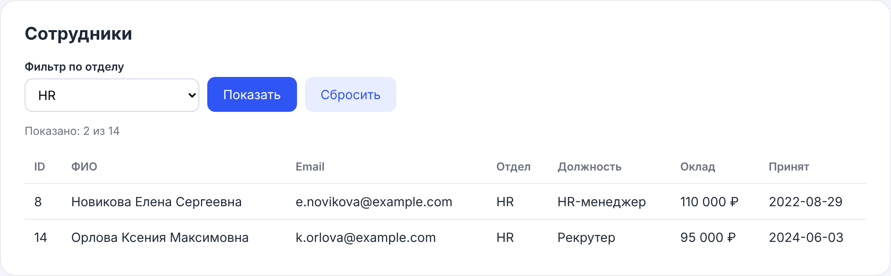
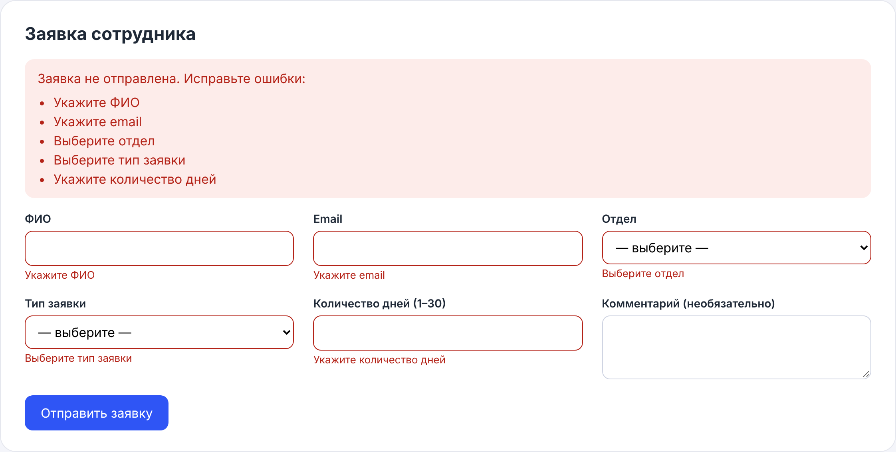
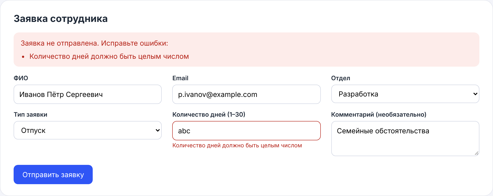
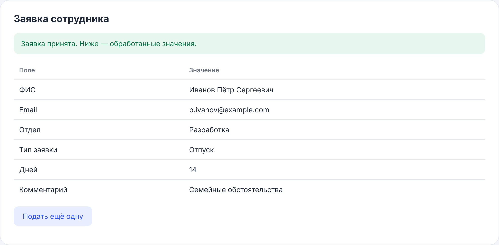
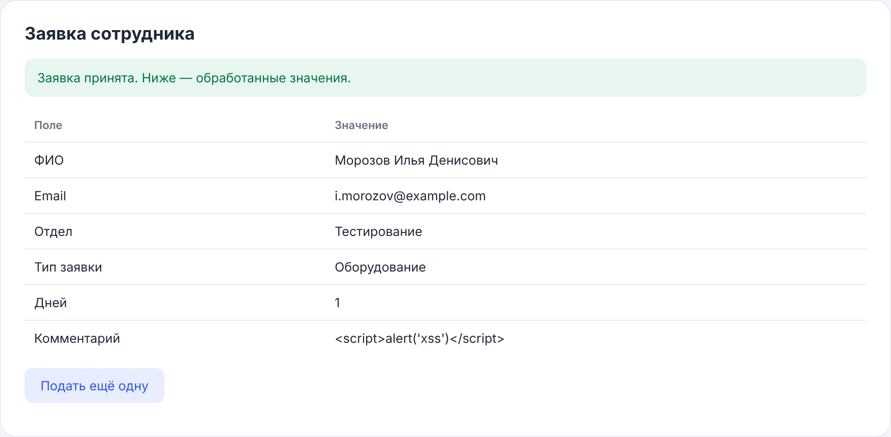
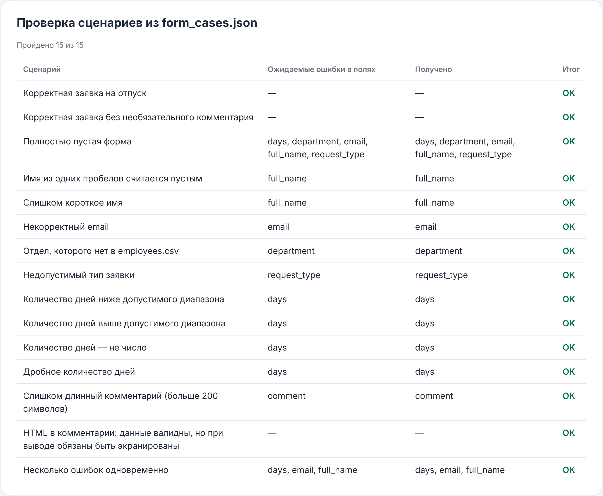
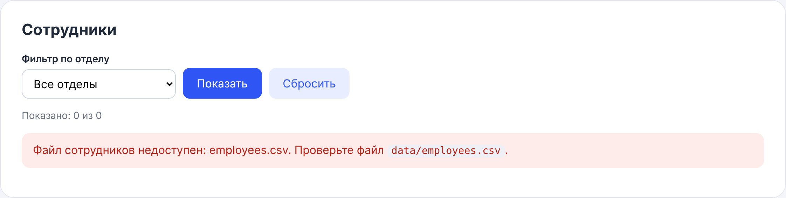

# ПР №4 — PHP. Основы языка, запросы и обработка HTML-форм

Небольшое PHP-приложение **без MVC**: таблица сотрудников из `employees.csv`, форма заявки сотрудника
с серверной валидацией и набор сценариев из `form_cases.json`, по которым автоматически проверяется валидатор.

## Технологии

PHP 8.1+ (разработано на 8.3), HTML5, CSS3. Внешних зависимостей нет — Composer и npm не нужны.

## Требования к окружению

- PHP 8.1 или новее (`php -v`) с расширениями `mbstring` и `json` (в стандартной поставке есть).

## Запуск (чистый запуск по README)

```bash
git clone <ссылка-на-репозиторий> trpo-pr04-student
cd trpo-pr04-student
php -S localhost:8000 -t public
```

Адрес приложения: <http://localhost:8000>

Режим ошибок: по умолчанию (локальная разработка) PHP показывает все предупреждения.
Для «боевого» режима: `APP_ENV=prod php -S localhost:8000 -t public` — ошибки скрываются.

Консольная проверка сценариев (без браузера):

```bash
php tests/run_cases.php
```

## Структура

```
public/index.php     точка входа: обработка запроса + HTML-вывод
public/style.css     оформление
src/functions.php    функции: loadEmployees, parseEmployeeRow, validateInput, filterEmployees, e() ...
data/employees.csv   список сотрудников (копия dataset)
data/form_cases.json сценарии проверки формы (копия dataset)
tests/run_cases.php  консольный прогон сценариев
docs/checklist.md    чек-лист проверки перед сдачей
```

## Использование файлов dataset

| Файл | Где используется |
|------|------------------|
| `employees.csv` | `loadEmployees()` читает его через `fgetcsv`; из него строится таблица, фильтр и список отделов для формы (допустимые значения поля «Отдел»). |
| `form_cases.json` | `loadFormCases()` + `runCase()` прогоняют каждый сценарий через `validateInput()`; результат OK/FAIL выводится в секции «Проверка сценариев». |

## Что менялось по шагам

- **Шаг 12** — вынесены функции в `src/functions.php` (`require_once`): HTML не содержит обработки CSV и правил валидации.
- **Шаг 13** — добавлен GET-параметр `?department=…`. Если параметра нет — показываются все записи; неизвестное значение игнорируется с понятным сообщением.

## Путь данных от формы до HTML-ответа

1. Браузер отправляет `POST /` с полями формы.
2. `index.php` передаёт `$_POST` в `validateInput()`.
3. `normalizeInput()` берёт только известные поля, значения приводит к строке и делает `trim()` (не-строки, например `name[]=x`, считаются пустыми).
4. `validateInput()` проверяет обязательность, длину ФИО, формат email, допустимость отдела и типа заявки, диапазон числа дней (1–30), длину комментария. Ошибки складываются в массив `[поле => сообщение]`.
5. Если ошибки есть — форма выводится снова с введёнными значениями и сообщениями возле полей; если нет — выводится подтверждение и таблица обработанных значений.
6. Любое значение при выводе проходит через `e()` (обёртка над `htmlspecialchars`).

## GET и POST

- **GET** — данные передаются в адресной строке (`?department=HR`), запрос можно сохранить в закладку и повторить; используется для *фильтра* — он ничего не изменяет.
- **POST** — данные передаются в теле запроса, не попадают в URL и историю; используется для *отправки формы*.

## Зачем `htmlspecialchars`

Преобразует `<`, `>`, `&`, `"`, `'` в HTML-сущности. Без этого введённая строка `<script>…</script>`
выполнилась бы в браузере (XSS). Со вторым аргументом `ENT_QUOTES` экранируются и кавычки, поэтому безопасно
подставлять значение внутрь атрибута `value="…"`. Сценарий `xss-comment` в `form_cases.json` проверяет это автоматически.

## Сценарий проверки (для защиты)

1. Открыть главную — в шапке версия и текущая дата (формирует PHP).
2. Выбрать отдел в фильтре → в таблице только его сотрудники; «Сбросить» → все 14.
3. Нажать «Отправить заявку» с пустой формой → сообщения возле каждого обязательного поля.
4. Ввести `abc` в «Количество дней» и валидные остальные поля → ошибка только у поля дней, остальные значения сохранились.
5. В комментарий ввести `<script>alert(1)</script>` → заявка принята, тег показан как текст.
6. Секция «Сценарии» — все 15 строк `OK`.
7. Ошибочное состояние: временно переименовать `data/employees.csv` → вместо таблицы понятное сообщение, без fatal error.

## Ограничения

Заявки не сохраняются (хранилища нет — это тема следующих работ); отделы берутся только из CSV;
валидация только серверная (атрибуты `required` специально не используются, чтобы проверять сервер).

## Скриншоты

**Главная: версия и дата формируются PHP, переменные разных типов**



**Таблица сотрудников из employees.csv (пустая должность — «не указана»)**



**GET-фильтр по отделу: ?department=HR**



**Пустая форма: сообщения возле каждого обязательного поля**



**Ошибка в поле «дней»: введённые значения сохранены**



**Корректная заявка: подтверждение и таблица обработанных значений**



**HTML в комментарии выводится как текст (htmlspecialchars)**



**Сценарии из form_cases.json: 15 из 15**



**Ошибочное состояние: нет employees.csv — понятное сообщение**


