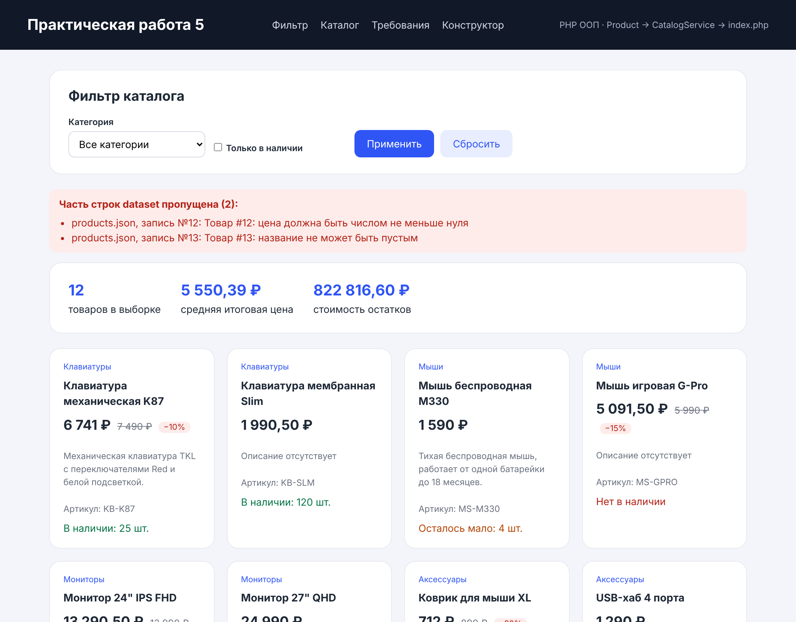
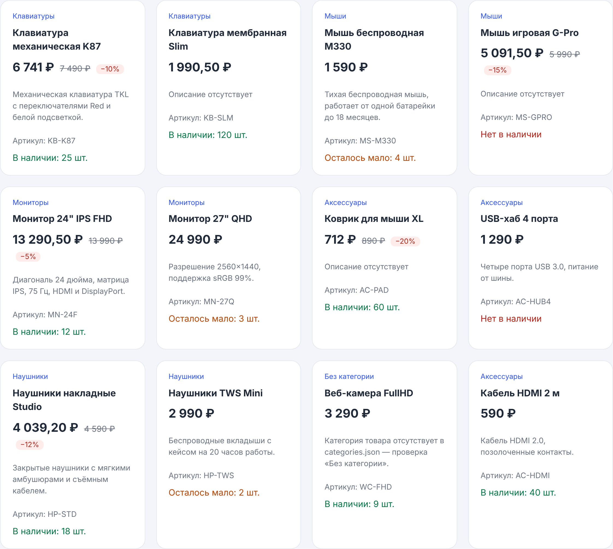
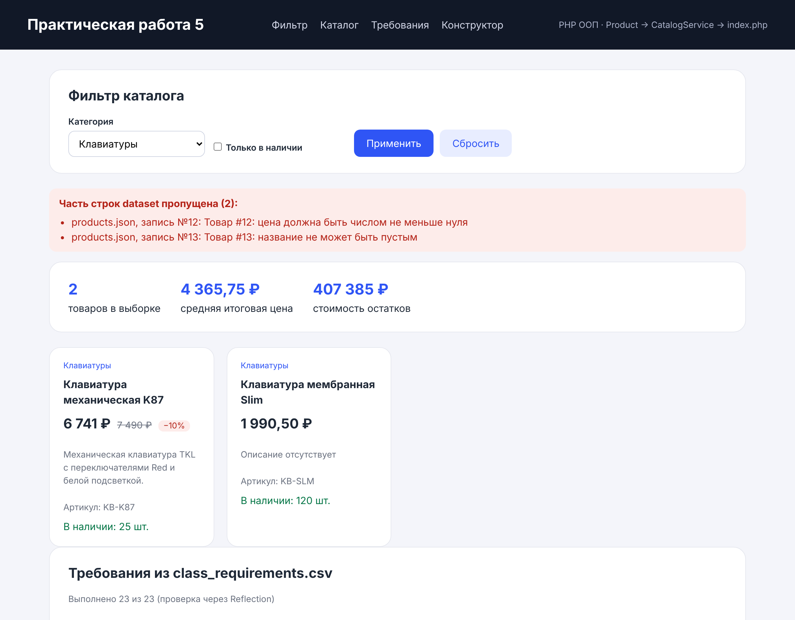
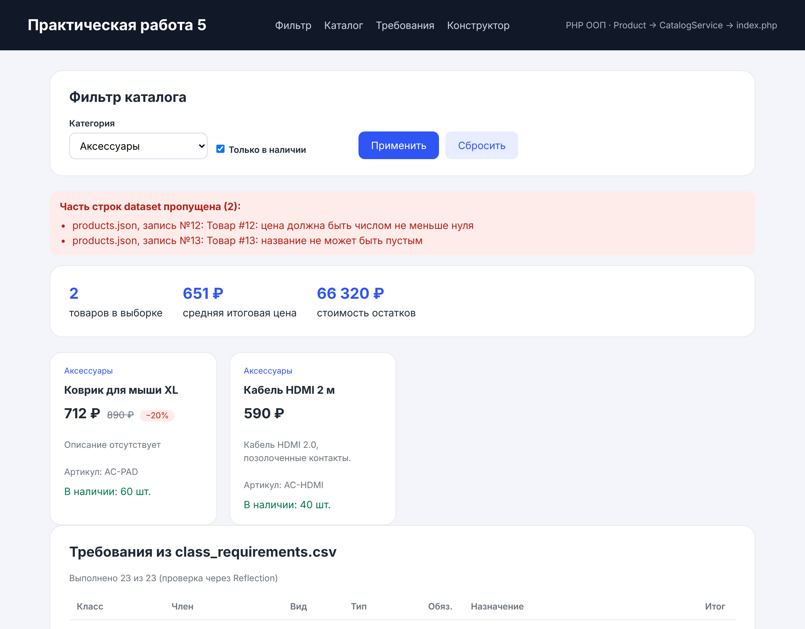
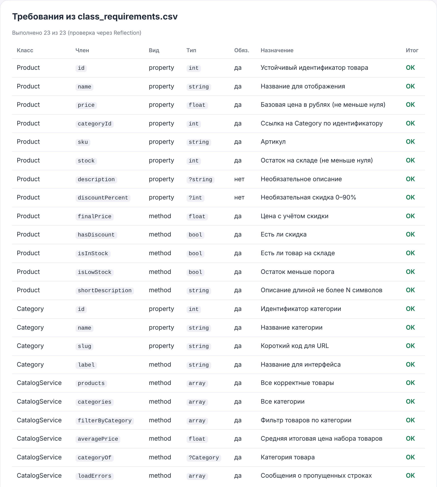
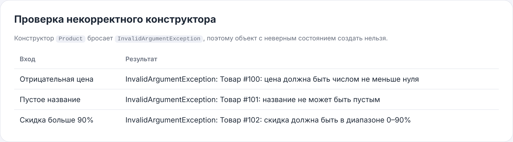
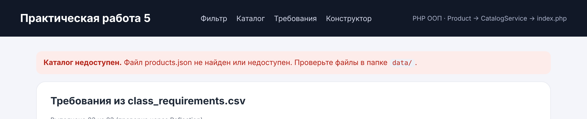

# ПР №5 — PHP ООП. Классы, конструкторы и модели предметной области

PHP-приложение «Каталог товаров». Данные из `products.json` и `categories.json` превращаются в объекты
`Product` и `Category`, а `CatalogService` загружает их, фильтрует по категории и считает агрегаты.
Файл `class_requirements.csv` описывает, какие свойства и методы должны быть у классов, — приложение
само сверяет с ним реальные классы (через Reflection) и показывает результат на странице.

## Технологии

PHP 8.1+ (разработано на 8.3), HTML5, CSS3. Зависимостей нет — Composer не нужен.

## Требования к окружению

PHP 8.1 или новее с расширениями `json` и `mbstring` (входят в стандартную поставку).

## Запуск (чистый запуск по README)

```bash
git clone https://github.com/prokope123-ux/TRPO-RNV-0225.git
cd TRPO-RNV-0225/pr05-php-oop
php -S localhost:8000 -t public
```

Адрес: <http://localhost:8000>. Для скрытия ошибок: `APP_ENV=prod php -S localhost:8000 -t public`.

Проверки из консоли:

```bash
php tests/constructor_check.php     # конструкторы и предметные методы
php tests/service_check.php         # CatalogService на данных dataset
php tests/requirements_check.php    # классы против class_requirements.csv
```

## Структура

```
public/index.php                   вывод: HTML-карточки, форма фильтра (только отображение и разбор GET)
public/style.css                   оформление
src/Model/Product.php              модель товара: конструктор, валидация, предметные методы
src/Model/Category.php             модель категории
src/Service/CatalogService.php     чтение JSON, создание объектов, фильтр, агрегаты
src/Service/RequirementsChecker.php сверка классов с class_requirements.csv
src/view_helpers.php               e() и formatPrice() — функции представления
data/                              копия dataset: products.json, categories.json, class_requirements.csv
tests/                             консольные проверки
docs/checklist.md                  чек-лист перед сдачей
```

## Схема и ответственность

```
products.json ─┐
categories.json┴─► CatalogService ──► Product / Category (объекты) ──► index.php ──► HTML
                    читает файлы,       хранят данные и поведение      разбирает GET,
                    создаёт объекты,    (finalPrice, isInStock ...),   вызывает сервис,
                    фильтр, агрегаты    проверяют себя в конструкторе  выводит с e()

class_requirements.csv ──► RequirementsChecker ──► таблица «Требования» на странице
```

- **Product / Category** — состояние одной сущности и операции над ней. Ничего не знают о HTML, файлах и `$_GET`.
- **CatalogService** — единственное место, где читаются JSON-файлы. Некорректные строки не роняют страницу, а попадают в `loadErrors()`.
- **index.php** — разбирает параметры фильтра, вызывает сервис и выводит результат. Обработка фильтра не смешана с классом `Product`.

## Предметные методы Product (шаг 4)

`hasDiscount()`, `finalPrice()`, `discountAmount()`, `isInStock()`, `isLowStock()`, `shortDescription()`, `belongsTo()`.
Метод `CatalogService::filterByCategory()` фильтрует каталог (шаг 8), `averagePrice()` и `stockValue()` считают агрегаты.

## Проверка всех строк products.json (шаг 13)

| Запись | Что проверяет | Результат |
|--------|---------------|-----------|
| №2 `price: 1990.5` | дробная цена | «1 990,50 ₽» |
| №2, №7 `description: null`, №4 `""` | пустое необязательное значение | «Описание отсутствует» |
| №4, №8 `stock: 0` | нет на складе | «Нет в наличии» |
| №3, №6, №10 `stock < 5` | малый остаток | «Осталось мало» |
| №11 `category_id: 999` | категории нет в categories.json | «Без категории» |
| №12 `price: -500` | некорректная цена | строка пропущена, сообщение на странице |
| №13 `name: "   "` | пустое название | строка пропущена, сообщение на странице |

## Что менялось по шагам

- **Шаг 4** — добавлены предметные методы вместо набора «пустых» getter/setter: логика скидки, наличия и короткого описания живёт в модели.
- **Шаг 10** — конструктор `Product` бросает `InvalidArgumentException` (id, название, цена, остаток, скидка). На странице блок «Проверка некорректного конструктора» показывает три сценария, в `tests/constructor_check.php` — восемь.

## Почему ручные `require_once` неудобны при росте проекта (шаг 12)

Сейчас `index.php` подключает каждый класс вручную. С ростом проекта: список подключений разрастается;
приходится помнить порядок (класс-родитель до наследника); забытая строка — fatal error в одном из сценариев;
при переименовании файла нужно править все `require_once`. Решение — автозагрузка (PSR-4 через Composer
или `spl_autoload_register`): PHP сам находит файл по имени класса и пространству имён. Это следующий шаг к MVC.

## Как добавить новое свойство в конструктор (для защиты)

1. В `Product::__construct` добавить параметр, например `private ?string $brand = null` (с значением по умолчанию, чтобы старый код не сломался).
2. Добавить метод чтения `brand()` и, при необходимости, проверку в конструкторе.
3. В `Product::fromArray` передать `$row['brand'] ?? null`.
4. В `index.php` вывести `$product->brand()` — HTML изменится в одном месте; сервис и остальные методы менять не нужно.
5. Добавить строку в `class_requirements.csv` — `RequirementsChecker` сразу проверит, что свойство появилось.

## Ограничения

Данные читаются целиком при каждом запросе; хранилище только для чтения; фильтр — один по категории и наличию;
классы подключаются вручную (см. выше); `Product` ничего не знает о формате вывода — форматирование цены лежит в `view_helpers.php`.

## Скриншоты

**Каталог: фильтр, предупреждения о пропущенных строках, агрегаты**



**Карточки товаров: скидка, остаток, «Без категории», «Описание отсутствует»**



**Фильтр по категории «Клавиатуры»**



**Фильтр: «Аксессуары» + «Только в наличии»**



**Классы против class_requirements.csv: 23 из 23 (Reflection)**



**Некорректный конструктор → InvalidArgumentException**



**Ошибочное состояние: нет products.json**


