# ПР №6 — PHP. Работа с файлами, JSON, сессиями и подготовка к MVC

Приложение «Менеджер заметок»: заметки хранятся в файле `notes.json`, состояние пользователя
(имя, режим интерфейса, избранное) — в `$_SESSION`, обработка запроса отделена от HTML-шаблонов.

## Технологии

PHP 8.1+ (разработано на 8.3), HTML5, CSS3, встроенный веб-сервер PHP. Composer и npm не нужны.

## Требования к окружению

PHP 8.1 или новее с расширениями `json`, `mbstring`, `session` (стандартная поставка). Для `tests/smoke.sh` — ещё `bash` и `curl`.
Каталог `data/` должен быть доступен процессу PHP на запись (в нём создаётся `*.lock` и временные файлы).

## Запуск (чистый запуск по README)

```bash
git clone https://github.com/prokope123-ux/TRPO-RNV-0225.git
cd TRPO-RNV-0225/pr06-php-json-session
php -S localhost:8000 -t public
```

Откройте <http://localhost:8000>. Для скрытия ошибок: `APP_ENV=prod php -S localhost:8000 -t public`.

Автопроверка (работает на копии `data/`, исходные файлы не меняет):

```bash
bash tests/smoke.sh
```

## Структура

```
public/index.php          единственная точка входа: сессия → POST-обработчик ИЛИ маршрут → render
public/style.css          оформление (светлая/тёмная тема)
src/storage.php           loadJson(), saveJson(), withFileLock() — вся работа с файлами JSON
src/notes.php             чтение заметок, validateNote(), addNote()
src/users.php             чтение users.json
src/state.php             состояние пользователя и applyAction() — единственное место изменения session
src/scenarios.php         прогон session_scenarios.json на чистой сессии
src/session.php           startSession(), flash-сообщения, состояние формы, CSRF
src/actions.php           handlePostRequest(): изменяет данные/session и делает redirect
src/pages.php             подготовка данных страниц (build*Page) — ДО подключения шаблона
src/view.php              e(), url(), render(), renderPage()
templates/                layout.php, list.php, users.php, scenarios.php, 404.php — только HTML
data/                     копия dataset: notes.json, users.json, session_scenarios.json
tests/smoke.sh            сквозная автопроверка
docs/checklist.md         чек-лист перед сдачей
```

Все внутренние ссылки начинаются с `/index.php?page=…` (функция `url()`); значения `page`: `notes`, `users`, `scenarios`.
Любое другое значение → страница 404 с HTTP-статусом 404.

## Использование файлов dataset

| Файл | Где используется |
|------|------------------|
| `notes.json` | Читается `loadNotes()` → список на странице «Заметки». Новые заметки дописываются `addNote()` через `saveJson()`. |
| `users.json` | `loadUsers()`: страница «Пользователи» и действие «Войти» — имя и режим интерфейса пользователя копируются в session. |
| `session_scenarios.json` | `loadScenarios()` + `runScenario()`: страница «Сценарии» воспроизводит последовательные запросы через ту же `applyAction()`, что и реальные формы. |

## Файловое хранилище (JSON)

- **Чтение** — `loadJson()`: `file_get_contents` + `json_decode(..., JSON_THROW_ON_ERROR)`. Любая проблема (нет файла, битый JSON, не тот формат) превращается в `StorageException` с понятным текстом; страница показывает сообщение, а не fatal error.
- **Запись** — `saveJson()`: данные пишутся во временный файл в том же каталоге, затем `rename()`. Читатель не увидит наполовину записанный файл.
- **Конкурентность** — `addNote()` выполняется под `flock` (`withFileLock()`): два одновременных POST не потеряют записи друг друга; `id` = `max(id) + 1` считается внутри блокировки.
- Код работы с JSON не дублируется: все обработчики используют `loadJson`/`saveJson`.

## Session

- `session_start()` вызывается в начале `index.php`, **до** любого вывода (иначе нельзя отправить `Set-Cookie`).
- В `$_SESSION['state']` хранится только состояние пользователя: `display_name`, `user_id`, `theme`, `favorites` (id избранных заметок). Сами заметки берутся из файла.
- Служебные ключи: `flash` (одноразовое сообщение), `form` (введённые значения после ошибки валидации), `csrf` (токен формы).
- Значение выводится в шапке; кнопка «Очистить имя» возвращает «Гость», кнопка режима переключает светлую/тёмную тему.
- После входа вызывается `session_regenerate_id(true)`.
- Cookie сессии: `HttpOnly`, `SameSite=Lax`.

### Обычная вкладка и приватное окно (шаг 11)

Состояние session связано с cookie `PHPSESSID`. Обычные вкладки одного браузера делятся одной cookie → **одна сессия**.
Приватное окно начинает с пустым хранилищем cookie → **новая, отдельная сессия**, а при его закрытии cookie удаляется.
Поэтому: вошли как «Анна Смирнова» в обычной вкладке — в приватном окне по-прежнему «Гость»; тема и избранное тоже не передаются.
`notes.json`, наоборот, общий для всех: добавленная заметка видна в обоих окнах. Различие «данные пользователя (session)» и «общие данные (файл)» — главный вывод этой работы.
Проверяется вручную по сценариям на странице «Сценарии» (поле «Проверить вручную») и автоматически в `tests/smoke.sh` с двумя отдельными cookie-файлами.

## Разделение обработчика и шаблона

```
запрос ─► index.php ─► POST?  ─► handlePostRequest(): валидация, изменение файла/session, flash, 303 redirect
                    └► GET   ─► build*Page(): читает файлы, готовит массив ─► render('list', $data) ─► layout.php
```

Шаблоны (`templates/*.php`) **не открывают файлы и не меняют `$_SESSION`** — они получают готовый массив и только выводят HTML через `e()`.
`render($template, $data)` подключает шаблон с изолированными переменными и возвращает строку; `renderPage()` вкладывает результат в `layout.php`.
POST всегда заканчивается redirect (Post/Redirect/Get), поэтому обновление страницы не повторяет отправку формы.

## Что менялось по шагам

- **Шаг 2** — вся навигация идёт через `public/index.php`; ссылки строит `url()`.
- **Шаг 10** — введены `render()` и `renderPage()`; `layout.php` общий для всех страниц.
- **Шаг 12** — состояние ошибки: отсутствующий или повреждённый JSON показывает блок с сообщением на соответствующей странице.
- **Шаг 13** — `?page=<неизвестное>` → 404 (`templates/404.php`), это подготовка к маршрутизации MVC.


## Ограничения такого подхода

- JSON-файл читается и переписывается целиком: при тысячах записей это медленно, нет индексов и запросов — нужна БД (SQLite/MySQL).
- `flock` защищает только процессы на одной машине; на нескольких серверах общий файл ненадёжен.
- Нет пользователей с паролями: «вход» — это учебный выбор имени, аутентификации нет.
- Сессии хранятся в файлах сервера и привязаны к браузеру; при масштабировании нужно общее хранилище сессий.
- Нет автозагрузки классов и маршрутизатора: `require_once` вручную, `if`/таблица маршрутов — следующий шаг MVC (контроллеры, `Views/`, репозитории).
- Тестовые правки `notes.json` попадают в Git, если работать не на копии: для автотестов используется переменная `APP_DATA_DIR`.

## Скриншоты

**Главная: заметки из notes.json, в шапке «Гость»**

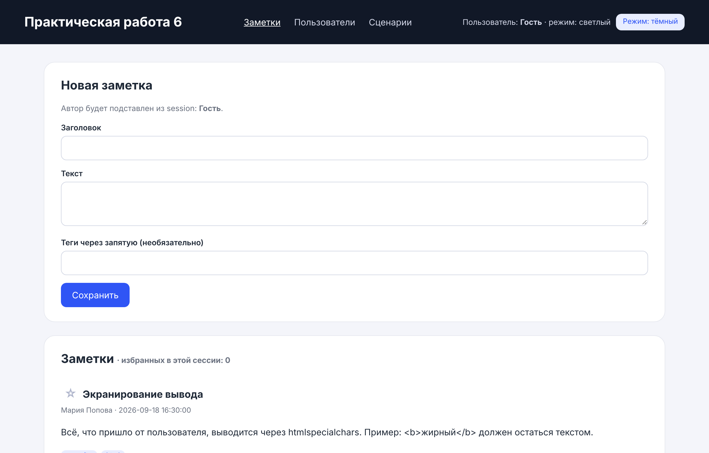

**Пользователи из users.json**

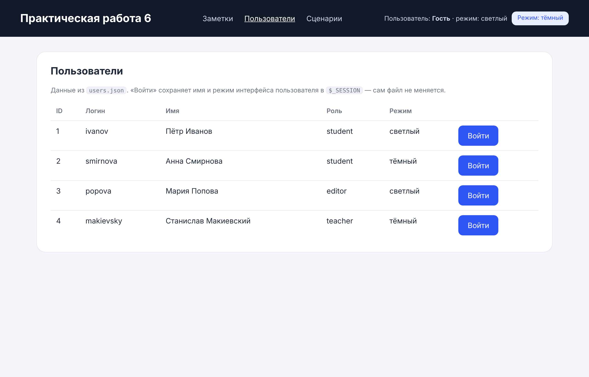

**Вход: имя и тёмная тема сохраняются в session**

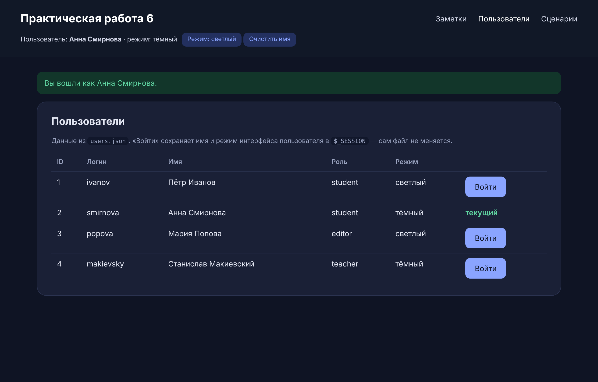

**Форма заметки: ошибки валидации, значения сохраняются**

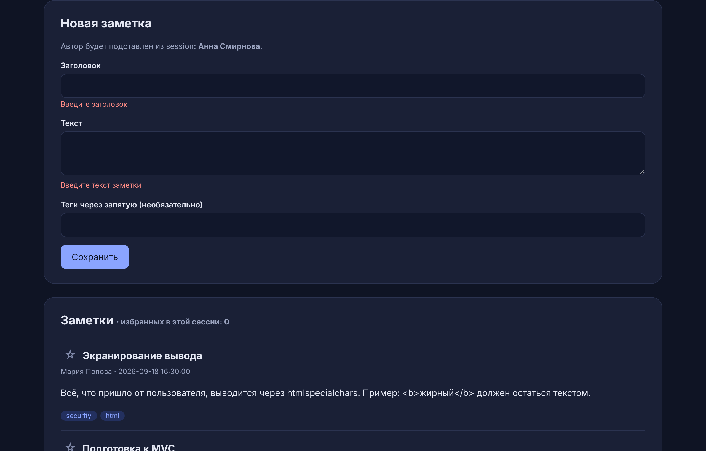

**После POST — redirect и одноразовое сообщение**

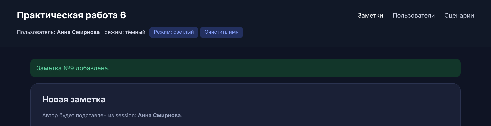

**Новая заметка записана в notes.json, автор — из session**

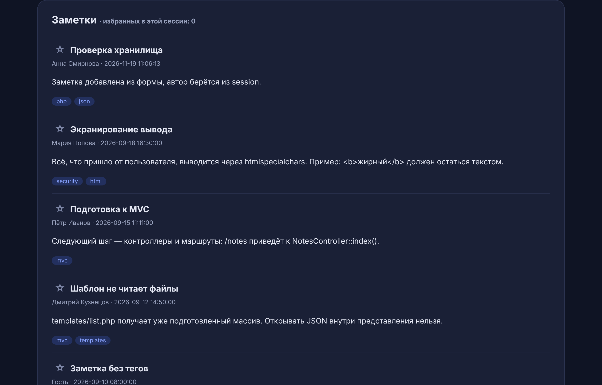

**Сценарии из session_scenarios.json: 8 из 8**

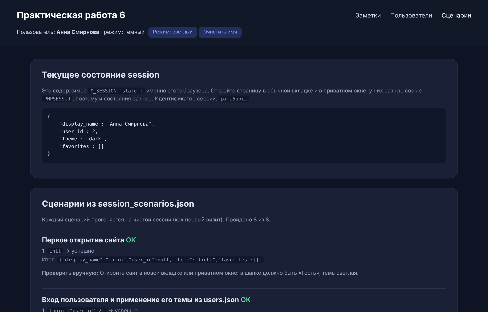

**Неизвестное значение page → страница 404**

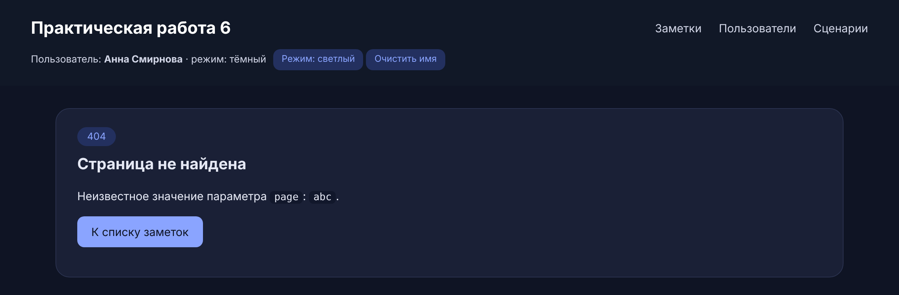

**Ошибочное состояние: повреждённый notes.json**

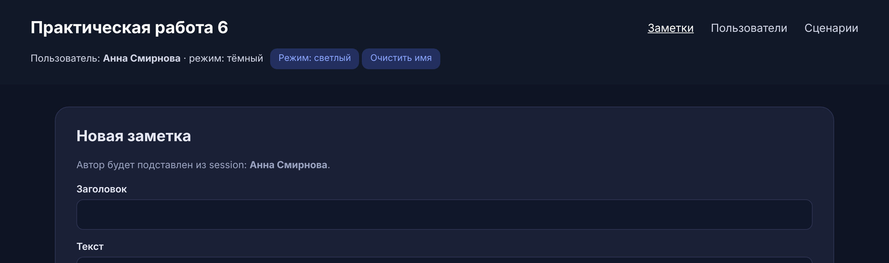

**Обычная вкладка: вошли как Анна Смирнова**

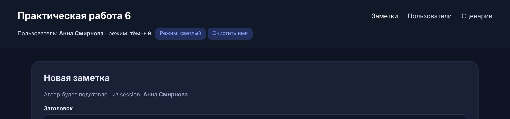

**Приватное окно: другая cookie → снова «Гость»**

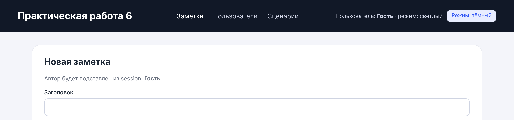
